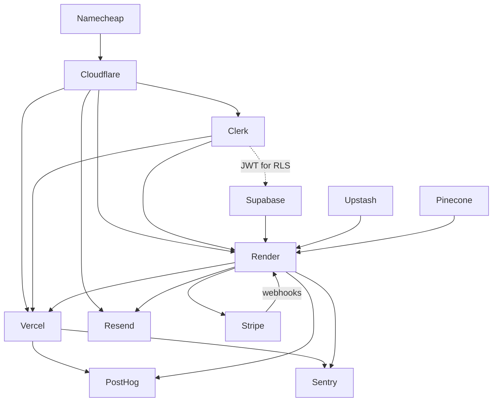

# Service dependency map

Inferred from the standard wiring of these tools. Confirm against the real architecture if it differs.

## Dependency table

| Service | Depends on | Depended on by |
|---|---|---|
| **Namecheap** | nothing (root) | Cloudflare (nameserver delegation) |
| **Cloudflare (DNS)** | Namecheap | Vercel, Render, Resend, Clerk (all need DNS records) |
| **Supabase** | nothing (root) | Render (main data store), Stripe webhook handler, Clerk (JWT used for RLS) |
| **Clerk** | DNS for a custom auth domain; Supabase if using JWT-based RLS | Vercel (frontend sessions), Render (token verification), Stripe (user-to-customer mapping), PostHog (user identify) |
| **Upstash (Redis)** | nothing (root) | Render (rate limiting, caching, background jobs) |
| **Pinecone** | embeddings source; Supabase/Clerk for user and tenant IDs | Render (vector search) |
| **Render (backend)** | Supabase, Clerk, Upstash, Pinecone, Stripe, Resend, env vars | Vercel (frontend calls the API), Stripe (webhook target), Sentry |
| **Vercel (frontend)** | Render API, Clerk, DNS, PostHog, Sentry | end users |
| **Resend** | DNS (SPF/DKIM/DMARC records on Cloudflare), domain from Namecheap | Render (sends email), Stripe flows (receipts, billing notices) |
| **Stripe** | Render (webhook endpoint), Supabase (stores subscription state), Clerk (user identity) | Resend (payment emails) |
| **PostHog** | Clerk (user ID), Vercel and Render (event sources) | nothing |
| **Sentry** | Vercel and Render (SDK in both) | nothing |

## Layered view

```
Layer 0  Foundation   : Namecheap -> Cloudflare (DNS)
Layer 1  Data/Identity: Supabase, Upstash, Pinecone, Clerk
Layer 2  Compute      : Render (backend)  ->  Vercel (frontend)
Layer 3  Business     : Stripe (needs Render webhook + Supabase), Resend (needs DNS records)
Layer 4  Observability: PostHog, Sentry (attach to Layer 2)
```

## Graph



## Recommended setup order

1. Namecheap domain, then Cloudflare DNS
2. Supabase, then Upstash, then Pinecone
3. Clerk (add DNS records)
4. Render backend (set env vars, connect Supabase/Upstash/Pinecone/Clerk)
5. Vercel frontend (point to Render API and Clerk)
6. Resend (verify domain with SPF/DKIM/DMARC)
7. Stripe (create webhook endpoint on Render, verify signatures)
8. PostHog and Sentry (add SDKs to both frontend and backend)
